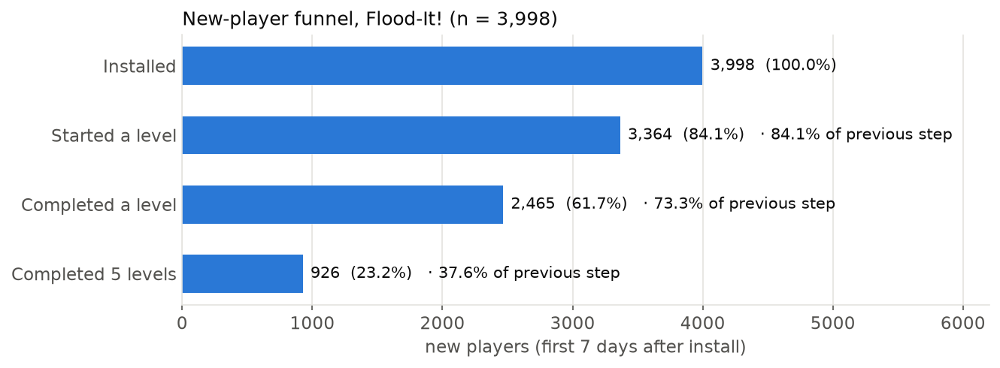
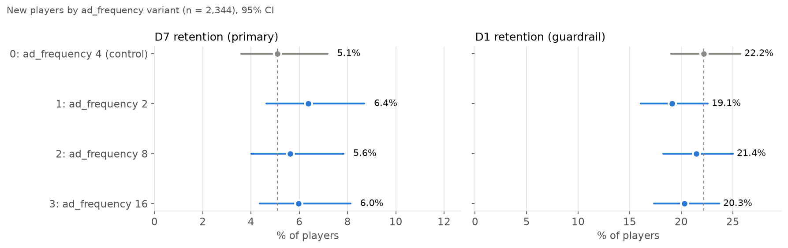

# Flood-It! product analytics: retention, funnel and an A/B test of ad frequency

Product analysis of a mobile puzzle game on raw Firebase / GA4 event data in **BigQuery**: new-player retention,
an onboarding funnel, a candidate activation metric, and a full readout of a 4-arm **A/B test** of ad frequency.

**Stack:** BigQuery SQL (nested GA4 schema, `UNNEST`, wildcard tables) · Python (pandas, SciPy, statsmodels, Matplotlib) · Jupyter

## Key findings

- **Retention is the main problem.** Of 3,998 new players, **19.8%** return the next day (D1) and **5.3%** on day 7 (D7).
- **The biggest drop-off is early progression.** 61.7% of new players complete a level in their first week,
  but only 37.6% of them go on to complete five.
- **Fast progress goes together with retention.** Players who complete 5 levels within 24 hours have about
  **2× higher D7** (8.5% vs 4.5%). This is a correlation, but it makes "5 levels on day 1" a candidate activation metric.
- **Ad frequency showed no detectable effect** on D7, D1 or playtime (2,344 new players, all p > 0.19,
  Holm-adjusted p ≥ 0.58). The experiment was healthy (no SRM, balanced) but **underpowered**: the minimum
  detectable effect was about **4.3 pp** on a 5% D7 base.
- **Recommendation:** keep the current ad frequency; rerun as a two-arm test with ~8,300 new players per arm
  and ad impressions tracked; in parallel, test changes that help players reach level 5 on day 1.

## Business question

Most revenue of a free mobile game comes from ads (only 27 of 15,175 players made an in-app purchase).
More ads can mean more revenue today but fewer players tomorrow. The developers ran a Firebase A/B test on the
Remote Config parameter `ad_frequency`. **Does showing ads more or less often change whether new players come back?**
To interpret the answer, I first measured how well the game retains new players and where they drop off.

## Data

Google's public Firebase sample dataset
`firebase-public-project.analytics_153293282.events_*`: ~5.7M events from 15,175 app installations over
114 days (2018-06-12 to 2018-10-03), 4,319 new installs (`first_open`).

- One row = one event (`event_name`, timestamp, `user_pseudo_id`), with nested `event_params` and `user_properties`.
- Experiment membership is stored in user properties (`firebase_exp_1` = variant), the tested setting in `ad_frequency`.
- The data is obfuscated by Google: IDs are random, some values are placeholders. A "user" is an app installation.

## Approach

| Step | Query / notebook | What it does |
|---|---|---|
| Explore | `sql/01`–`04` | dataset size, events, user properties, experiments and their variants |
| Check the experiment | `sql/04c_exp1_ad_frequency_check.sql` | maps exp_1 variants to `ad_frequency` values (0 → 4 control, 1 → 2, 2 → 8, 3 → 16) |
| Retention | `sql/05_retention_d1_d7.sql` | D1 / D7 of new players, only cohorts whose day 7 is inside the data |
| Funnel | `sql/06_new_user_funnel.sql` | install → started level → completed level → completed 5 levels (first 7 days) |
| Activation | `sql/06b_activation_vs_d7.sql` | D7 for players who completed 5 levels within 24 h vs the rest |
| Experiment table | `sql/07_experiment_users.sql` | one row per exp_1 participant: variant, day 0, D1, D7, minutes, compliance |
| Analysis | `notebooks/01_retention_and_funnel.ipynb`, `notebooks/02_ab_test_ad_frequency.ipynb` | tables, charts, statistical tests |

Definitions: **active** = a `session_start` or `user_engagement` event that day; **D*N*** = active on day *N*
after day 0 (classic N-day retention); **minutes** = sum of `engagement_time_msec` in the first 7 days.

## Results

### Retention and funnel

| D1 | D7 | New players |
|---|---|---|
| 19.8% (790) | 5.3% (212) | 3,998 |



16% of new players never start a level, and the steepest loss is between the first and the fifth completed level.

| Completed 5 levels within 24 h | Players | D7 |
|---|---|---|
| Yes | 821 | 8.5% |
| No | 3,177 | 4.5% |

### A/B test: ad frequency (Firebase experiment 1)

**Population.** 4,924 participants. Primary analysis on **2,344 new players** assigned on their install day,
with day 7 inside the data (590 / 565 / 569 / 620 per variant), so day 0 means the same for everyone.

**Health checks**

- **SRM:** none (χ² p = 0.56 on all participants, p = 0.36 on new players).
- **Balance:** the other randomized parameter `initial_extra_steps` is balanced (p = 0.78), so is the share of new players (p = 0.96).
- **Compliance:** new players carried their assigned `ad_frequency` on ~100% of events. Mismatches came from players
  who were in the game before the experiment, so they are handled by the sensitivity checks.

**Results (new players)**

| Variant | `ad_frequency` | D7 | Δ vs control (95% CI) | D1 | Median minutes, week 1 |
|---|---|---|---|---|---|
| 0 (control) | 4 | 5.1% | | 22.2% | 3.4 |
| 1 | 2 | 6.4% | +1.3 pp (−1.4; +4.1) | 19.1% | 3.2 |
| 2 | 8 | 5.6% | +0.5 pp (−2.1; +3.2) | 21.4% | 3.7 |
| 3 | 16 | 6.0% | +0.9 pp (−1.7; +3.5) | 20.3% | 3.1 |



- Two-proportion z-tests with **Holm correction** for 3 comparisons: no significant difference in D7 or D1.
  Playtime compared with **Mann–Whitney U** and **bootstrap** CIs: no significant difference.
- **Sensitivity:** the same conclusion for all participants (intention-to-treat) and per-protocol.
- **Power:** with ~570 players per arm and D7 ≈ 5%, the **MDE is ≈ 4.3 pp** (80% power, α = 0.05).
  Detecting a 1 pp change would need **~8,300 new players per arm**, about 15× more.
- The most-ads variant (2) has the lowest D1 (−3.1 pp, CI −7.7; +1.6). Not significant, but the direction
  a follow-up test should check first.

### Recommendations

1. **Do not change `ad_frequency` based on this test.** It cannot tell a small effect from no effect.
2. **Redesign the test:** control vs one alternative, sample size computed up front, and ad impressions and ad revenue
   tracked, so the retention cost can be weighed against revenue.
3. **Work on early progression:** the largest drop-off and the strongest retention signal are both around
   completing 5 levels on day 1. Candidates for experiments: an easier first levels curve, more starting extra steps.

## Limitations and assumptions

- **The meaning of `ad_frequency` is not documented.** I assume it means "an ad every N levels or games", so a higher
  number means fewer ads.
- **Regular ad impressions are not tracked** in the data (only rewarded ads), so exposure to ads cannot be verified.
- **Installations, not people:** a reinstall looks like a new player. `app_remove` is logged on Android only.
- **2018 sample data of one game.** The goal is to show the method, not to give advice for today's market.

## Reproduce

1. Open the BigQuery sandbox (free, no billing) and run the files in `sql/` against the public dataset.
2. Export the result of `07_experiment_users.sql` to `data/07_experiment_users.csv` (included).
3. `pip install -r requirements.txt`, then run the notebooks in `notebooks/` from that folder.

```
sql/          BigQuery queries 01–07
data/         07_experiment_users.csv (one row per experiment participant)
notebooks/    01_retention_and_funnel.ipynb, 02_ab_test_ad_frequency.ipynb
figures/      charts used in this README
results/      test results as CSV
```

---
Dina Gudkova · [LinkedIn](https://linkedin.com/in/dina-gudkova) · [GitHub](https://github.com/dinagudkova)
